# solid.cpp

<div align="center">


**llama.cpp, hardened: real bugs found, root-caused, and measured before they ship**

Big MoE models on hardware people actually own, not a rack of enterprise GPUs: proven live, not just claimed.
A curated fork of [llama.cpp](https://github.com/ggml-org/llama.cpp): MoE expert-cache placement and
speculative-decoding fixes, each one measured before and after on real hardware, not assumed, plus a live Brain/Atlas
view so you can watch the cache work instead of taking it on faith.

[](https://opensource.org/licenses/MIT)
[](https://github.com/ggml-org/llama.cpp)
[](#this-branch)

</div>

> **Legacy, updated 22 Nov 2026.** solid.cpp (August to October 2026) was the learning ground. What survived measurement was
> ported, one concept at a time, into [Strata-HotRod](https://github.com/sangharshadhyeta/Strata-HotRod) (branch `main`), which is
> the engine to use. This branch keeps solid.cpp's changed sources and notes, and the 18 Nov 2026 write-up, for the record. The
> project's own repository is [sangharshadhyeta/solid.cpp](https://github.com/sangharshadhyeta/solid.cpp), with its
> [docs page](https://sangharshadhyeta.github.io/solid.cpp/).

## What it taught, and where each lesson went

<p align="center"></p>

<div align="justify">

| Learned in solid.cpp | Built into Strata-HotRod |
|---|---|
| **Stand-ins are the biggest lever, but they break the text if pushed too far.** On Qwen3.8-Flash-Next (87 GB) on a 12 GB card: expert cache off 3.7 tok/s, cache on 8.3, cache plus stand-ins 12.85; the most aggressive setting produced text like "a question to how a steps explaining on the how quicksort" at a respectable-looking speed | Stand-ins decided by confidence (`router weight x logit gap <= budget`): from rank 2, 42.2 tok/s, 9 of 9 answers read as sound (rank 0 broke them) |
| **A CPU-thread predictor lost:** late, lossy guesses do not pay | A learned look-ahead on the card, starting from the model's own router, 1 / 2 / 4 layers ahead: +8% code, +15% reasoning, +8% prose |
| **Pinning the hottest experts lost,** because pinned pages cannot be reclaimed | The RAM tier is page-locked in segments and handed back (`STRATA_PIN_SEGS`): +9% on the RTX 3060 PC |
| **The drive sets the speed:** fix the reads before tuning anything | Link budgeting, one layer at a time: an 8,554-token prompt read in 16.9 s, 262K context fits |
| **Measure in pairs, with a control,** and retract what turns out to be noise | The test ledger: a decision stays untested until a row holds a measurement |

</div>

Each speed above is from one PC (RTX 3060 12 GB, i5-12400F, 30 GB RAM, NVMe) and has not been independently reproduced. The full
story, with the checks that were wrong and the settings that wrecked the text, is the write-up: [`index.html`](index.html) (open it
from a local copy in a browser) and its print copy [`print/technical-note.html`](print/technical-note.html).

## GLM-5.3-Flash on 42 GB of total memory

<div align="justify">

Ran the 93 GB UD-IQ1_S quant of GLM-5.3-Flash (320B total / 18B active) on an RTX 3060 12 GB + i5-12400F +
30 GB RAM: 42 GB combined, well under Unsloth's own stated practical minimum of about 102 GB for this model. It
loads and generates correctly: 1.39 tok/s prompt processing, 1.18 tok/s generation, all 45 layers' experts
CPU-resident (12,960 experts) with a 3.97 GB GPU expert cache running a 38.7% hit rate. We could not find a
published benchmark of this model running below its stated minimum footprint anywhere else. This was measured once.

This was only possible after fixing a real bug: `llama.cpp` eagerly `MAP_POPULATE`s the entire model file into
RAM at load time regardless of whether it fits, which OOM-crashes any model bigger than available RAM even
when `-ncmoe` correctly keeps the CPU-offloaded experts lazily paged from disk otherwise. The fix makes that
prefetch conditional on the model actually fitting in available RAM, restoring genuine lazy NVMe-backed expert
weights for oversized models.

The planned run of the same model on an NVIDIA H200 with 512 GB RAM, at Q4, for a fair-hardware comparison, was never made.

</div>

### Reproduce it

<div align="justify">

The project's repository builds; this branch does not (it holds only the files written or changed for solid.cpp, on the base
llama.cpp commit `1f368f354` of 13 August 2026). The repository's only branch is `mtp-qwen4exp` (the earlier instructions named a
`solid` branch that does not exist):

</div>

```sh
git clone -b mtp-qwen4exp https://github.com/sangharshadhyeta/solid.cpp.git
cd solid.cpp
cmake -B build -DGGML_CUDA=ON   # drop -DGGML_CUDA=ON for a CPU-only build
cmake --build build --config Release -j$(nproc)

./build/bin/llama-server \
  -hf unsloth/GLM-5.3-Flash-GGUF:UD-IQ1_S \
  -ncmoe 45 --moe-cache auto \
  -c 2048 --parallel 1 --host 0.0.0.0 --port 8099
```

<div align="justify">

The eager-mmap-prefetch fix means this loads and serves correctly even on a machine with under 64 GB of combined VRAM+RAM, where
it would otherwise OOM at load time.

</div>

## This branch

| Path | What it is |
|---|---|
| [`solid-cpp/`](solid-cpp) | The changed sources of the llama.cpp fork (MoE expert cache, stand-ins, speculative-decoding fixes) and its notes: [`docs/ROADMAP.md`](solid-cpp/docs/ROADMAP.md), [`docs/LEARNINGS.md`](solid-cpp/docs/LEARNINGS.md), [`docs/plan.md`](solid-cpp/docs/plan.md), [`docs/moe-cache-colibri-notes.md`](solid-cpp/docs/moe-cache-colibri-notes.md), [`docs/moe-cache-planner-scope.md`](solid-cpp/docs/moe-cache-planner-scope.md), [`docs/feature-interaction-audit.md`](solid-cpp/docs/feature-interaction-audit.md) |
| [`index.html`](index.html) | The illustrated write-up of 18 Nov 2026: how experts are placed, what solid.cpp found, how each lesson became part of HotRod, the results |
| [`print/technical-note.html`](print/technical-note.html) | The formal print copy, with the references |
| [`assets/`](assets) | The pictures the pages use |
| [`CITATIONS.md`](CITATIONS.md) | Every project, paper, model, dataset and person credited |
| [`UPSTREAM.md`](UPSTREAM.md) | What is whose |

## Credit and license

<div align="justify">

solid.cpp is built on **[llama.cpp](https://github.com/ggml-org/llama.cpp)** by ggml-org and contributors (MIT; its notice and
authors are kept in [`solid-cpp/LICENSE-llama.cpp`](solid-cpp/LICENSE-llama.cpp) and
[`solid-cpp/AUTHORS-llama.cpp`](solid-cpp/AUTHORS-llama.cpp)). The prior art, papers, models and benchmarks behind it are in
[`CITATIONS.md`](CITATIONS.md). Everything else in llama.cpp is its authors' work and is not copied here. MIT licensed
([`LICENSE`](LICENSE)).

</div>
