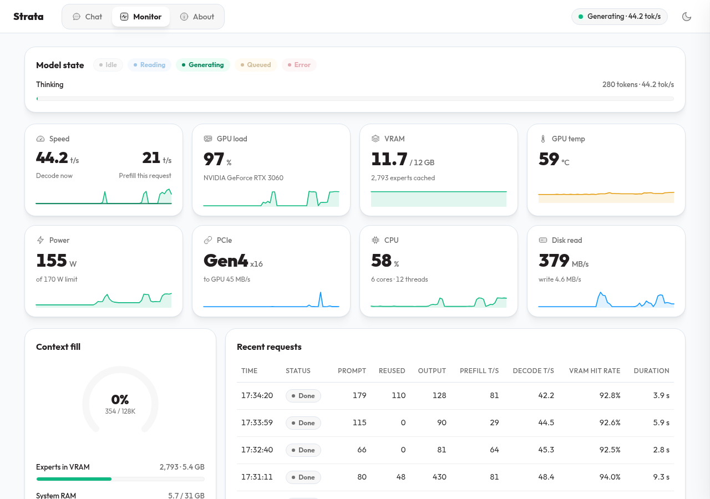
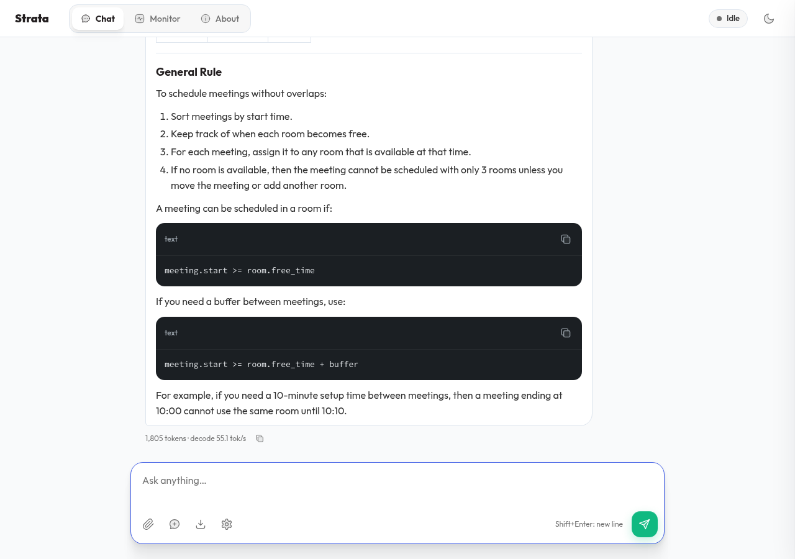

<p align="center"><i><s>A system which rewires the model around the way you use it.</s>Coming Soon</i></p>

<p align="center"></p>

<h1 align="center">Strata-HotRod</h1>

<h2 align="center">111 GB of model. 30 GB of RAM. 12 GB of VRAM. Zero cloud.</h2>

<p align="center"><b>A 125-billion-parameter AI on one gaming card, streaming from your SSD.</b><br>
Nothing leaves your PC.</p>

<p align="center">
🔥 <b>hot experts</b> on the card &nbsp;→&nbsp; 🌡️ <b>warm</b> in RAM &nbsp;→&nbsp; ❄️ <b>cold</b> on the SSD
</p>

<p align="center">
  
  
  
  
  
</p>

<p align="center">
  
  
  <a href="LICENSE"></a>
</p>

<p align="center">
  <a href="#how-fast">Speed</a> ·
  <a href="#what-you-see">The app</a> ·
  <a href="#how-it-works">How it works</a> ·
  <a href="#install">Install</a> ·
  <a href="#credits-and-license">Credits</a>
</p>

---

<table>
<tr>
<td align="center" width="25%"><h2>🧊 78 - 111 GB</h2>of model on a <b>30 GB</b> PC (IQ3_S and UD-Q4_K_XL)</td>
<td align="center" width="25%"><h2>🔥 50-70 / 15-22</h2>tokens/s on one RTX 3060: IQ3_S (131K context, short answers)</td>
<td align="center" width="25%"><h2>🐋 341 GB</h2>DeepSeek-V4.1-Flash: see the <a href="https://github.com/sangharshadhyeta/Strata-HotRod/tree/upstream-dsv41"><b>upstream-dsv41</b> branch</a></td>
<td align="center" width="25%"><h2>⚡ 0.4 s</h2>to pick up a 45K-token conversation (next turn, from the saved state)</td>
</tr>
</table>

<div align="justify">

A fork of [Strata](https://github.com/Niko1221/Strata) by Niko1221 and contributors (MIT). Strata keeps Qwen's experts in
RAM and reads from the SSD when RAM is short; its docs call that path much slower. This fork works on that path: it
spreads the experts over the card, RAM and the SSD and guesses ahead which ones to read, so the 78 GB IQ3_S runs on 30 GB
of RAM at 50-70 tokens/s (131K context, short answers; the table below has the long prompts), and Unsloth's 111 GB UD-Q4_K_XL
on the same PC at 15-22 tokens/s in short tests on 14 Nov (131K context, three questions, a 29K-token prompt read at 300-420
tokens/s; the learners were still cold, and it has not been measured as widely as IQ3_S).

</div>

> ### 🐋 Looking for DeepSeek-V4.1-Flash? It is on another branch.
> **Go to the [`upstream-dsv41` branch](https://github.com/sangharshadhyeta/Strata-HotRod/tree/upstream-dsv41)**: it has its own engine
> (`strata-dsv41`), its own install steps and its own README, for the full model (IQ2_XXS, 7.5-8 tokens/s over a whole answer on this PC, peaking near 10) and
> the **Coder** (a half-expert coding version, about 9 tokens/s). Everything on this page, `setup.py` included, is for Qwen3.8-Flash-Next.
> The two branches are kept apart on purpose.

## Can Qwen3.8-Flash-Next run on an RTX 3060 12 GB with low RAM?

<div align="justify">

**Yes.** On one RTX 3060 12 GB with 30 GB of RAM and an NVMe SSD, this fork runs Qwen3.8-Flash-Next (Qwen 3.8 Flash Next,
125B) as the 78 GB IQ3_S at **50-70 tokens/s** (131K context; 262K fits). The experts that do not fit in RAM are read from
the SSD, and a look-ahead guesses ahead which ones. Measured on one PC: see [How fast](#how-fast) and the "Not tested"
list at the bottom.

**How much RAM does it need?** This fork was measured on 30 GB. Strata's setup recommends 64 GB for IQ3_S and says that
with less RAM it reads the rest from the SSD, much slower.

**Does it need a cloud service?** No. Everything runs on your PC. Setup downloads the model once from Hugging Face.

</div>

> **Tested on one machine, with one model.** Other cards, AMD, Windows, macOS and other model sizes may work in upstream
> Strata; we have not run them, so we do not describe them here.

## How fast

<div align="justify">

Measured on the machine below; a token is about ¾ of a word. Every answer in these runs was read and checked.

</div>

<table width="100%">
<tr><th align="left">Answer</th><th align="right">tokens/s (24 Oct, 131K context)</th></tr>
<tr><td align="left">Code (a Python function, 500-650 tokens)</td><td align="right">52 - 55</td></tr>
<tr><td align="left">Reasoning (a two-train problem, ~1,000 tokens)</td><td align="right">66 - 71</td></tr>
<tr><td align="left">Story (a paragraph, 100-150 tokens)</td><td align="right">50 - 53</td></tr>
</table>

<table width="100%">
<tr><th align="left">Long prompts (262K context, 20 Oct)</th><th align="right">Read in</th><th align="right">Answer written at</th></tr>
<tr><td align="left">8,554 tokens</td><td align="right">16.9 s</td><td align="right">52 - 54 tokens/s</td></tr>
<tr><td align="left">45,398 tokens</td><td align="right">67 - 68 s</td><td align="right">38 - 41 tokens/s</td></tr>
<tr><td align="left">The same 45K conversation, next turn</td><td align="right">0.4 - 0.5 s</td><td align="right">34 - 45 tokens/s</td></tr>
</table>

<div align="justify">

The first message of a chat is the slow part: it waits on the SSD for the model's experts. Follow-ups reuse what was
already read. A 262K context costs about 8% against 131K, because more of the attention's memory streams from RAM.

</div>

<details>
<summary><b>The machine</b></summary>

<table width="100%">
<tr><th align="left"></th><th align="left"></th></tr>
<tr><td align="left"><b>Graphics card</b></td><td align="left">NVIDIA GeForce RTX 3060, 12 GB (driver 610.57, CUDA 13.3)</td></tr>
<tr><td align="left"><b>Processor, RAM</b></td><td align="left">Intel Core i5-12400F (6 cores, 12 threads), 30 GB</td></tr>
<tr><td align="left"><b>Disk</b></td><td align="left">500 GB NVMe (WD Blue SN5000) on a PCIe 3.0 link; the model files live on it</td></tr>
<tr><td align="left"><b>System</b></td><td align="left">Rocky Linux 9.6, built with gcc-toolset-13</td></tr>
<tr><td align="left"><b>Engine</b></td><td align="left">Strata 0.1.45 (upstream, merged 17 Oct 2026) plus this fork's changes</td></tr>
<tr><td align="left"><b>Model</b></td><td align="left"><a href="https://huggingface.co/Qwen/Qwen3.8-Flash-Next">Qwen3.8-Flash-Next</a>, IQ3_S (about 3.5 bits per weight, 78 GB of files) by <a href="https://huggingface.co/ISTA-DASLab/Qwen3.8-Flash-Next-GSQ-RCO-GGUF">ISTA-DASLab</a></td></tr>
<tr><td align="left"><b>Context</b></td><td align="left">262K tokens (the longest prompt served so far: 114K)</td></tr>
</table>
</details>

<details>
<summary><b>Answer quality</b></summary>

<div align="justify">

Strata replaces some of a token's experts with similar ones already on the card to stay fast. In a small test (50 maths
questions, 30 coding questions, answers read by hand): 47 of 50 and 30 of 30 correct, against 48 of 50 and 30 of 30 with
nothing replaced. A test this small cannot show a difference of one or two answers either way. Since 24 Oct every JSON and
code answer in the structured-output checks has been valid. Detail: [SPEC.md](SPEC.md).

**Re-check on and off (9 Nov):** 3 short and 3 long answers (2,500 tokens each, a CPU explanation, a 150-line program, a
multi-step tank problem), run twice, every answer read in full with its thinking: all correct and clean in both settings
(no loops, stray tokens or broken words); 42-44 tokens/s with the re-check off, 31-34 with it on.

**MMLU-Pro (30 Oct): 87.1%** - 183 of 210 questions (15 from each of its 14 subjects), thinking on, 32K context,
temperature 0, the stand-ins on; every answer finished cleanly (no cut-offs or loops). For comparison, published Vals
scores: Qwen3.8-27B 84.3%, Qwen3.8 Max 88.6%.

</div>
</details>

## What you see

<p align="center"><br>
<sub>The <b>Monitor</b>: speed, card load and memory, the experts on the card, each request's hit rate.</sub></p>

<p align="center"><br>
<sub>The <b>Chat</b>: under every answer, the number of tokens and the speed.</sub></p>

## How it works

<div align="justify">

The model has 512 experts per layer and picks 10 for every token; only some fit on the card. Everything this fork adds is
about the ones that do not.

</div>

<table>
<tr>
<td width="50%" valign="top">

<div align="justify">

**Stand-in experts.** A missing expert is replaced by one already on the card only when
`router weight × logit gap ≤ budget`. **For extra certainty**, the flip re-check (`"STRATA_FRAGILE_RECHECK": "1"`) recomputes
exactly the few tokens a stand-in could have flipped; with it on, the budget also tunes itself by measured speed and the
stand-ins, the mask and the substitute corrections keep learning. It is off by default since 9 Nov: about a quarter slower,
and every answer we read was correct either way.

</div>

</td>
<td width="50%" valign="top">

<div align="justify">

**A look-ahead that learns.** Experts for 1, 2 and 4 layers ahead are guessed on the card and read from the SSD before they
are needed. Each guess is the router's own score plus a small correction learned live from the real routing; its size is
chosen per layer by a live contest, and it falls back to the plain router if it ever does worse. For Qwen3.8 IQ3_S setup downloads a trained one ([release](https://github.com/sangharshadhyeta/Strata-HotRod/releases/tag/predictor-qwen38-iq3s-v2), 5.4 MB: 91 / 85 / 78% of the needed experts guessed 1 / 2 / 4 layers ahead) and it keeps learning on your PC; for other models it is off until `STRATA_LA_LEARN=1` starts one. DeepSeek's trained one is a manual download (see the DeepSeek install below).

</div>

</td>
</tr>
<tr>
<td valign="top">

<div align="justify">

**Three tiers: card → RAM → SSD.** The hottest experts on the card, the next in a RAM tier sized from free memory, the
rest on the SSD. Swap rounds move a chat's experts onto the card in the background.

</div>

</td>
<td valign="top">

<div align="justify">

**Long prompts, long memory.** Prompts are read layer by layer, each layer's experts once, straight from the SSD.
Past 64K the attention's memory streams from RAM, and a long conversation resumes from a saved state in under a second.

</div>

</td>
</tr>
<tr>
<td valign="top">

<div align="justify">

**Draft and check.** A small draft head guesses the next words; the big model checks several at once.

</div>

</td>
<td valign="top">

<div align="justify">

**Nothing hand-set.** Budgets, reserves of RAM and video memory, and what the look-ahead learned are measured on your PC
and kept across restarts.

</div>

</td>
</tr>
</table>

<table width="100%">
<tr><th align="left">Needed experts guessed (live, 24 Oct)</th><th align="center">Plain router</th><th align="center">Learned look-ahead</th></tr>
<tr><td align="left">1 layer ahead</td><td align="center">77-79%</td><td align="center"><b>85-88%</b></td></tr>
<tr><td align="left">2 layers ahead</td><td align="center">66-69%</td><td align="center"><b>76-79%</b></td></tr>
<tr><td align="left">4 layers ahead</td><td align="center">55-58%</td><td align="center"><b>66-71%</b></td></tr>
</table>

<div align="justify">

Every change and its measurement: [docs/HOTROD-DETAILS.md](docs/HOTROD-DETAILS.md) · the predictor study:
[docs/PREDICTOR-EXPERIMENTS.md](docs/PREDICTOR-EXPERIMENTS.md) · the full log of ideas tried: [docs/perf-ideas.md](docs/perf-ideas.md) ·
earlier experiments from a separate fork: [docs/EARLIER-EXPERIMENTS.md](docs/EARLIER-EXPERIMENTS.md).

**New on main (9 Nov):** the flip re-check is opt-in (`STRATA_FRAGILE_RECHECK=1`; off: 42-44 vs 31-34 tokens/s on this
PC at 262K, answers correct in both); the shift cap is opt-in (`STRATA_SHIFT_CAP=1`); the stand-in learner learns from the
real experts again (it had read zeros since 8 Nov); a substitute-correction learner with a flip mode
(`STRATA_SUBFIT_APPLY=flip`, needs the re-check; it applies a pair's correction only where its own held-out test shows a
gain - none has on Qwen IQ3_S yet).

**New in v0.1.45-hotrod.2 (31 Oct):** the learned look-ahead v2 (trained with a rank-weighted loss) is the one setup
downloads; the expert placement comes from routing traces (`tools/placement/solve.py`); the Monitor's decode timeline
runs only when you press Record (it cost 5-13% always on). Opt-in: the draft head's experts in slots with the rest
computed exactly from RAM (`STRATA_MTP_SLOTS`, `STRATA_MTP_ZC`), and the look-ahead ring weighted by each layer's CPU
cost (`STRATA_RING_COST`).

</div>

### Every setting

<div align="justify">

Each model has its own config (`strata-iq3_s.json` here): engine settings go in its `"env"` (a blank value means the
engine's default), engine flags in `"args"`, server settings at the top level. Every switch, flag and server key, with
its default and what it does: [docs/FEATURES-qwen.md](docs/FEATURES-qwen.md) (generated from the code by
`tools/features_ref.py`).

</div>

## DeepSeek-V4.1-Flash too

<div align="justify">

**For DeepSeek, go to the [`upstream-dsv41` branch](https://github.com/sangharshadhyeta/Strata-HotRod/tree/upstream-dsv41)**: its
README there is the one to follow. The same ideas ported to upstream Strata's DeepSeek engine run **DeepSeek-V4.1-Flash**
(Starw1's uncensored GSQ-RCO IQ2_XXS backbone with DeepSeek's MXFP8 Engram, 341 GB of files) on this same PC at **7.5-8
tokens/s over a whole answer** (the best answers peak near 10; 13 Nov, six runs of three questions; 6.33 on 6 Nov before later changes), and its **Coder** version (half the experts, about 285 GB) at about 9. That
branch is upstream Strata 0.2.7.1 plus this fork's DeepSeek work, with its own engine, `strata-dsv41`; the two branches are kept
apart and ported by hand.

What it adds to upstream's DeepSeek engine, on by default when the ring is on (`=0` turns each off):

- **A VRAM ring** (`DS4_RING=32`): the learned look-ahead's guesses for the next 1-2 layers are copied from a page-locked
  RAM store into card slots; a pick uses its slot only if the copy has landed in time.
- **Sticky ring** (`DS4_RING_STICKY`): a landed copy stays until its slot is needed, so a later token that picks the same
  expert reuses it (about 80,000 reuses in one answer).
- **The prompt pass's buffers as ring slots** (`DS4_LEND`, `DS4_LEND_RING`): the 1 GB the chunked prompt pass keeps on
  the card holds 99-100 more ring slots while the model answers, and is handed back before a long prompt.
- **A self-adjusting copy limit** (`DS4_RING_INFLIGHT`, auto): copies in flight follow the measured decode speed
  (128-token averages, a 3% dead band; it settles at 11-12 on this PC). `=fixed` keeps 12.
- **Stand-ins with their re-check and self-tuning budget**, the learned look-ahead and the learned VRAM reserve, as on Qwen.
- **The RAM store gives back its coldest idle chunk** (unpinned first) when RAM runs short, and takes chunks back later.
- **Pictures**: with Unsloth's `mmproj-BF16.gguf` in the pack (`--mmproj` to `pack_gguf.py`) and `--vision on`, the
  engine's own vision tower reads images (319 MiB of VRAM; checked on a known picture: shapes, colours, positions and text
  right). Known issue: with the tower on, the RAM store is sized 0 and the ring turns off (a free-RAM drop is taken for a
  unified-memory machine); the fix is pending.

Measured and left opt-in: `STRATA_LA_TAIL_READ=3` (a learned read-ahead of lower-ranked guesses: 23% slower, the drive is
already at its limit here) and `DS4_PCIE_BALANCE=1` (Qwen's dynamic balance ported: its copies arrive too late and it is
not yet safe - do not turn it on). DeepSeek's limit on this PC is the NVMe at about 2.8 GB/s.

</div>

## Install

<div align="justify">

You need a recent NVIDIA driver, the CUDA 13 toolkit, gcc-toolset-13 (Rocky Linux 9; other distributions are untested),
**Python 3.10 or newer with venv** and free disk on an NVMe: setup refuses to start below **about 137 GB free** for IQ3_S on a PC whose
RAM cannot hold the experts (its low-RAM mode, like this 31 GB PC): the 84 GB download, a 50 GB copy of the experts it writes for that mode,
and room for the MTP layer (setup.py's check, `need = to_fetch + MTP + arena`). Rocky / Alma / RHEL 9 ship `python3` as 3.9, which is
too old: install `sudo dnf install -y python3.12 python3.12-pip` first (`setup.sh` looks for `python3.13` down to
`python3.10` by name, then `python3`). The CUDA 13 toolkit and the NVIDIA driver are not installed for you.

What was tested from an empty folder (13 Nov, RTX 3060, Rocky Linux 9, CUDA 13.3, gcc-toolset-13): the `git clone` and
`setup.sh --check` (which is how the Python problem above was found), a CMake configure of the clone with setup's CUDA flags,
and `setup.sh --model IQ3_S ... --build` in the fresh clone up to its disk check (PC check, the `.venv` and its packages, the
questions; it then stopped at the disk check, because this PC does not have that much free next to the files already on it: the
84 GB model download, the compile and the first start were **not** run from an empty folder). The engine and model on this PC were
installed by the same steps earlier.

</div>

```bash
sudo dnf install -y git gcc-toolset-13
git clone https://github.com/sangharshadhyeta/Strata-HotRod.git
cd Strata-HotRod
scl enable gcc-toolset-13 -- ./setup.sh --model IQ3_S --context 131072 --build --yes --no-start
```

<div align="justify">

- `--build` compiles this fork's engine; without it setup downloads upstream's, which lacks these changes. The compiled
  engine was checked against the one measured here: the same speed.
- For Qwen3.8 IQ3_S it also downloads the learned look-ahead's trained state (5.4 MB, SHA-256 checked) into `data/`. It is the
  `predictor-qwen38-iq3s-v2` release; a later `-v3` (the same file trained for another week) is on the releases page, and
  setup does not use it yet.
- For 262K context set `--max-context 262144` in the config's `args`.
- `--model IQ3_S` is the size tested here. Setup says it wants a 64 GB PC; naming it is the consent, and it runs on 30 GB.
- `--models-dir /path/on/nvme` puts the model files elsewhere.

</div>

<div align="justify">

**Run** inside a memory limit (94% of RAM; two uncapped runs once froze this PC):

</div>

```bash
systemd-run --scope -p MemoryMax=$(awk '/MemTotal/ {printf "%dK", $2 * 0.94}' /proc/meminfo) -p MemorySwapMax=0 \
  .venv/bin/python serve/server.py --engine strata --config strata-iq3_s.json \
  --port 8095 --host 0.0.0.0 --api-key YOUR_KEY
```

<div align="justify">

When it prints `ready: http://127.0.0.1:8095/v1`, open `http://127.0.0.1:8095`. For this PC only, leave out `--host` and
`--api-key`.

</div>

<div align="justify">

**On your own PC** the engine fits itself to the machine; the first hour of use is that fitting, so it starts slower:

- **Measured at start:** the VRAM reserve (learned per card and context), the RAM tier (sized from free memory) and which
  experts sit on the card or in RAM (the most used first).
- **Measured while it serves (with the re-check on):** the stand-in budget and the mask's depth, each by an alternating
  speed test over the same stretch of text (the faster setting is kept only when it does not add flips). A faster or slower
  drive moves them where they belong on that machine. With the re-check off (the default) the values already learned are
  used as they are: the stand-in budget bounds the stand-ins, fixed (`"STRATA_ROUTE_BUDGET_FIXED": "0"` lets any resident
  stand-in in, about 3% faster).
- **Learned from your use:** the look-ahead, the mask and the stand-ins (below).
- **Learned files** sit in `data/`, named by the model's id: `standin-tune-<id>.txt`, `mask-learn-<id>.bin`,
  `standin-learn-<id>.bin`, `subfit-learn-<id>.bin`, `predictor-<id>.bin`, plus `ram-reserve.json`. They hold this machine's values: when you move an
  install to another PC, delete all but `predictor-<id>.bin` (the look-ahead belongs to the model and carries over) and
  let them relearn.
- **For better certainty, turn the flip re-check on** - add to the config's `"env"`:

  ```json
  "STRATA_FRAGILE_RECHECK": "1"
  ```

  The few tokens a stand-in could have flipped (6-8 in 100 here) are then recomputed with the real experts, and the learning
  below runs. It costs about a quarter of the speed (31-34 instead of 42-44 tokens/s on this PC at 262K). Every answer we
  read was correct either way; turn it on for long or high-stakes answers, or to let the engine keep fitting itself.
- **The learned mask** (7 Nov, CUDA; needs the re-check and route-resident stand-ins): each re-checked token
  measures how much the masked experts changed the output; the least harmful of the little-used experts are masked, the
  proven-harmless ones at every rank, and the depth follows the speed test. The look-ahead learns the picks that cost a read
  4x harder (`STRATA_LA_EXACT_W`, default 4) and gives the experts the mask removed no weight. `"STRATA_MASK": "0"` and
  `"STRATA_LA_EXACT_W": "1"` turn them off (do so on AMD or Apple). Opt-in (all need the re-check): `"STRATA_STANDIN_LEARN": "1"`,
  `"STRATA_STANDIN_BALANCE": "1"` (no gain shown yet) and `"STRATA_SUBFIT_APPLY": "flip"` (the substitute corrections).
- **What to watch** in the server log after a request (the tests and learners need the re-check on): `auto mask test` and `auto budget test` (each test's speeds and
  what it kept), `mask learn:` (share, masked, at all ranks, re-check divergence) and `look-ahead learner:` (its guess rates
  against the plain router).
- **Smaller machines:** lower `--max-context` first (the KV cache is the largest fixed cost); setup refuses a PC that cannot
  hold the fixed weights.

</div>

<div align="justify">

**Update:** `scl enable gcc-toolset-13 -- ./update.sh --build` (new code, engine rebuilt where it changed, model kept).

</div>

### DeepSeek-V4.1-Flash

<div align="justify">

About **345 GB free on an NVMe** (139 GB of model, the 203 GB Engram table, 1 GB for pictures), the
same toolchain, and the Qwen checkout above, installed with `--build` (that step downloads the pinned llama.cpp into its
`third_party/llama.cpp`, which the DeepSeek engine builds against; a fresh clone does not have it). These are
the commands this PC was set up with; the branch's own `setup.py --model Starw1-2.00bpw-MXFP8` downloads the same files
and makes the pack, but that route is untested here.

</div>

```bash
# the DeepSeek branch beside the Qwen checkout (run from inside Strata-HotRod, where the Qwen install left you)
git fetch origin upstream-dsv41 && git worktree add ../Strata-HotRod-ds upstream-dsv41
cd ../Strata-HotRod-ds
PY=../Strata-HotRod/.venv/bin/python   # the Qwen install's venv runs this branch's server and tools too

# the engine (sm_86 = RTX 30-series; set yours)
scl enable gcc-toolset-13 -- bash -c 'cmake -G Ninja -S . -B build-dsv41 -DCMAKE_BUILD_TYPE=Release \
  -DSTRATA_ENABLE_CUDA=ON -DSTRATA_BUILD_TESTS=OFF -DSTRATA_BUILD_DSV41=ON -DSTRATA_NATIVE_EXPERTS=ON \
  -DCMAKE_CUDA_ARCHITECTURES=86-real -DSTRATA_GGML_DIR=$PWD/../Strata-HotRod/third_party/llama.cpp \
  && ninja -C build-dsv41 strata-dsv41'

# the model (M: the folder for the files): Starw1's 4 shards + the MXFP8 Engram, Unsloth's metadata shard,
# and for pictures Unsloth's mmproj-BF16.gguf in $M/..
M=/mnt/nvme/models/deepseek41-flash/GSQ-RCO-IQ2_XXS
$PY - "$M" <<'EOF'
import sys
from huggingface_hub import hf_hub_download, snapshot_download
m = sys.argv[1]
snapshot_download("Starw1/DeepSeek-V4.1-Flash-1017-Uncensored-GSQ-RCO-IQ2_XXS-MXFP8-Engram-GGUF", local_dir=m)
hf_hub_download("unsloth/DeepSeek-V4.1-Flash-1017-GGUF", "DeepSeek-V4.1-Flash-1017-UD-Q8_K_XL-00001-of-00009.gguf",
                local_dir=m + "/unsloth")
hf_hub_download("unsloth/DeepSeek-V4.1-Flash-1017-GGUF", "mmproj-BF16.gguf", local_dir=m + "/..")
EOF

# the pack (a few MB of index beside the files; no weights are copied)
$PY tools/dsv41/pack_gguf.py --model $M \
  --shards DeepSeek-V4.1-Flash-1017-GSQ-RCO-IQ2_XXS-0000{1,2,3,4}-of-00004.gguf \
  --engram $M/DeepSeek-V4.1-Flash-Engram-MXFP8.gguf \
  --engram-meta $M/unsloth/DeepSeek-V4.1-Flash-1017-UD-Q8_K_XL-00001-of-00009.gguf \
  --mmproj $M/../mmproj-BF16.gguf --out /mnt/nvme/strata-data/packs/ds41v
cp data/dsv41/profile-2.00.bin /mnt/nvme/strata-data/packs/ds41v/expert-profile.bin

# the learned look-ahead (8 MB, trained on this pack's 384 experts; the engine loads it at start and keeps learning).  Optional: without it
# the look-ahead starts empty and learns from your use.  Setup's DeepSeek route is not used here, so this is a manual download.
P=/mnt/nvme/strata-data/packs/ds41v/hotrod-predictor.bin
curl -L -o $P https://github.com/sangharshadhyeta/Strata-HotRod/releases/download/predictor-ds41-starw1-v2/hotrod-predictor-ds41-starw1-v2.bin
echo "3e27dbab99643d7bc3f6cf72d5a7a28b5cd3a4ca6625c4d4b2a1672a75d5def9  $P" | sha256sum -c -   # must say OK; delete the file if not
```

<div align="justify">

**The config** `strata-ds41.json` (the ring and stand-ins are switched on here; everything above follows from them):

</div>

```json
{
 "exe": "/path/to/Strata-HotRod-ds/build-dsv41/strata-dsv41",
 "args": ["--pack", "/mnt/nvme/strata-data/packs/ds41v", "--max-context", "262144", "--eos", "1",
          "--vision", "on", "--dspark", "auto"],
 "cwd": "/path/to/Strata-HotRod-ds",
 "tokenizer": "/mnt/nvme/strata-data/packs/ds41v/tokenizer",
 "model_name": "deepseek-v4.1-flash",
 "arch": "deepseek41",
 "engine_ready_s": 3600,
 "env": {"DS4_RING": "32", "DS4_RING_PIN": "1", "STRATA_STANDIN": "1"},
 "answer_room": false,
 "reasoning_budget_tokens": 0
}
```

<div align="justify">

- `"answer_room": false` and `"reasoning_budget_tokens": 0`: no limit but the context (otherwise DeepSeek's thinking
  stops at 32,768 tokens and a client's cap keeps a quarter for the answer).
- `--vision off` (or leaving out `--mmproj` when packing) gives text only, and today the faster setup (see the known issue).
- **Run** it as Qwen, in the same memory limit, from `Strata-HotRod-ds` with `$PY serve/server.py --engine strata --config strata-ds41.json`. The first start at a new context size
  learns its VRAM reserve; if it prints `ring: off (... would not fit)`, start it once more.
- **On your own PC** it fits itself to the machine as Qwen does (above); its learned files sit in the pack folder
  (`standin-tune.txt`, `vram-reserve.txt`, `mask-learn.bin`, `standin-learn.bin`, `hotrod-predictor.bin`) - when you move a
  pack to another PC, delete all but `hotrod-predictor.bin`. The learned mask and the look-ahead's weighting are on by default
  with the stand-ins (`"DS4_MASK": "0"` turns the mask off); stand-in learning and balance are opt-in.

</div>

## Using it

<div align="justify">

Any OpenAI-compatible client works with **`http://127.0.0.1:8095/v1`** and your API key:

</div>

```bash
curl http://127.0.0.1:8095/v1/chat/completions \
  -H "Authorization: Bearer $KEY" -H "Content-Type: application/json" \
  -d '{"model":"strata","temperature":1.0,"top_p":0.95,"max_tokens":300,
       "messages":[{"role":"user","content":"Name the three largest cities in India."}]}'
```

<div align="justify">

- **Thinking** is on by default; the chat menu picks off, low, medium or high.
- **Sampling:** with no temperature set, decoding is greedy. The model card recommends temperature 1.0, top-p 0.95, top-k 20
  with thinking on, and 0.7 / 0.8 / 20 with it off.
- **Reading while you type:** the chat page sends your draft as you pause, so Send only reads what changed. Programs can do
  the same with `"strata_prefill": true` (or `X-Strata-Prefill: 1`, or `/v1/prefill`).
- **Pictures (optional):** add a `"vision"` section to the config; a message can then carry an `image_url`
  ([docs/IMAGES.md](docs/IMAGES.md)).
- **One request at a time;** others wait their turn.

</div>

<div align="justify">

Every option: [docs/DETAILS.md](docs/DETAILS.md) (upstream's reference; it covers more than we tested).

</div>

<details>
<summary><b>Not tested</b></summary>

<div align="justify">

- Any other graphics card, any AMD card, Windows, macOS or another Linux.
- Any other model or size (Q2_0, IQ2_XS, IQ3_XXS, Coder, Swift, Unsloth's files).
- Several requests at once, or two graphics cards.
- A prompt that fills the whole 262K window (the longest served: 114K tokens).

</div>
</details>

## Credits and license

<div align="justify">

The model is Qwen3.8-Flash-Next by the Qwen team, compressed by ISTA-DASLab. Strata is by Niko1221 and its contributors;
this fork keeps its [MIT License](LICENSE) and copyright notice. The engine uses parts of
[llama.cpp / ggml](https://github.com/ggml-org/llama.cpp), and the picture encoder uses llama.cpp's `mtmd`. A few parts and
every model have their own licenses: [docs/HOW_IT_WORKS.md](docs/HOW_IT_WORKS.md#license). Security: [SECURITY.md](SECURITY.md).

</div>

<details>
<summary><b>Ideas this fork builds on</b></summary>

<div align="justify">

Several changes were first built and measured in [solid.cpp](https://github.com/sangharshadhyeta/solid.cpp), a llama.cpp
fork for MoE expert caching, and ported here one concept at a time. Prior art behind them:

</div>

<div align="justify">

- [leloch/llama.cpp](https://github.com/leloch/llama.cpp) (moe-cache-pr): the original GPU-resident MoE expert cache.
- [thecodacus/llama.cpp](https://github.com/thecodacus/llama.cpp) (prefetch-experts, from the
  [Codacus](https://www.youtube.com/@Codacus) channel): expert prefetch overlapped with compute.
- [JustVugg/colibri](https://github.com/JustVugg/colibri): LFRU eviction and the Expert Atlas method; its
  [router-prediction experiment](https://github.com/JustVugg/colibri/issues/200) showed where a predictor stops paying.
- [FlashML-org/FreeToken](https://github.com/FlashML-org/FreeToken): the hit/miss split for expert uploads.
- [antirez/ds4](https://github.com/antirez/ds4): the three-tier layout and explicit reads instead of mmap.
- [aswinkumar99/qwen3.8-flash-next-expert-traces](https://huggingface.co/datasets/aswinkumar99/qwen3.8-flash-next-expert-traces)
  (CC-BY-4.0): the expert-predictor study on this model; the learned look-ahead uses its training target (the router's top-32
  scores plus a hinge), and `--expert-predictor on` downloads its published predictor.
- [vLLM](https://github.com/vllm-project/vllm): a reference for the model's code, and not reserving memory for unused context.
- Papers: FlexGen ([2303.06865](https://arxiv.org/abs/2303.06865)) and MoE-Lightning
  ([2411.11217](https://arxiv.org/abs/2411.11217)) for layer-by-layer prompts; Stream2LLM for reading the prompt while it is
  written; the expert-prefetch literature (Speculating Experts [2603.19289](https://arxiv.org/abs/2603.19289), PILOT / Fate
  [2502.12224](https://arxiv.org/abs/2502.12224), FineMoE, SP-MoE [2510.10302](https://arxiv.org/abs/2510.10302), ProMoE,
  PowerInfer-2).

</div>
</details>
