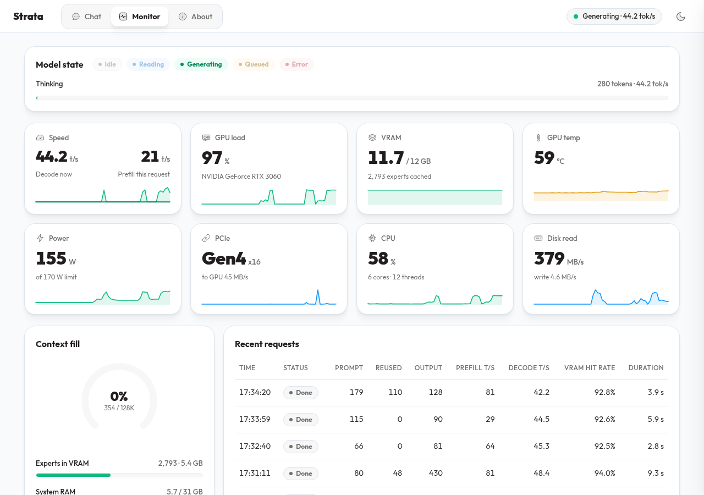
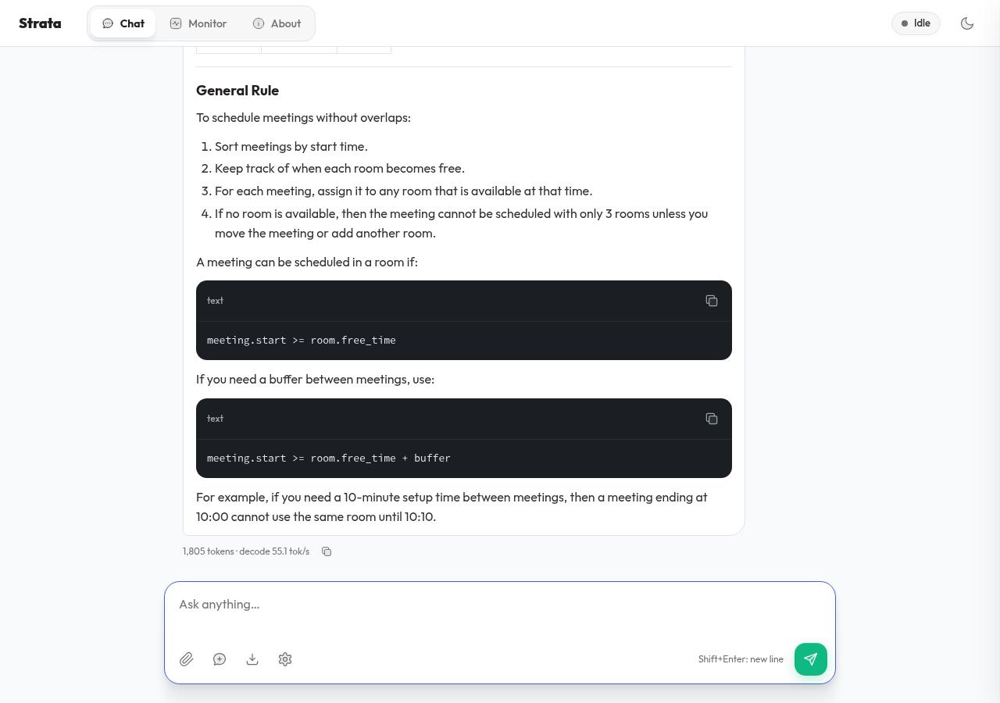

<p align="center"></p>

<h1 align="center">Strata-HotRod</h1>

<p align="center"><b>A 125-billion-parameter model on a 12 GB gaming card.</b><br>
Qwen3.8-Flash-Next on one RTX 3060 with 30 GB of RAM: 40-54 tokens/s, 262K tokens of context, nothing leaves your PC.</p>

This is a fork of [Strata](https://github.com/Niko1221/Strata) by Niko1221 and contributors (MIT). Strata runs a model that
normally needs a server by keeping the most-used parts on the graphics card and streaming the rest from the SSD.

**Everything in this README was tested on one machine, with one model.** Other graphics cards, AMD, Windows, macOS and
other model sizes may work in upstream Strata, but we have not run them, so we do not describe them here.

**At a glance**

- **Fast where it counts:** 52-54 tokens/s after an 8.5K-token prompt, 38-45 tokens/s deep into a 45K-token conversation.
- **Long memory:** 262K tokens of context on a 12 GB card; the K/V streams from RAM past 64K.
- **Quick follow-ups:** the next turn of a 45K conversation is read in half a second; your draft is read while you type.
- **Careful shortcuts that tune themselves:** an expert that is not on the card is swapped for a close stand-in only when
  the router's confidence says it is cheap, and any token a stand-in could have flipped is decided again exactly. The engine
  finds its own budget by measured speed and keeps what it learned ([how it works](#stand-in-experts)).
- **A look-ahead that learns** which experts the next layers need, live on the card ([how](#the-learned-look-ahead)).
- **Every number measured, every answer read:** the changes and their A/B results are in
  [docs/perf-ideas.md](docs/perf-ideas.md).

## What was tested

| | |
| --- | --- |
| **Graphics card** | NVIDIA GeForce RTX 3060, 12 GB (driver 610.57, CUDA 13.3) |
| **Processor, RAM** | Intel Core i5-12400F (6 cores, 12 threads), 30 GB |
| **Disk** | 500 GB NVMe (WD Blue SN5000); the model files live on it |
| **System** | Rocky Linux 9.6, built with gcc-toolset-13 |
| **Engine** | Strata 0.1.45 (upstream, merged 17 Oct 2026) plus the changes below |
| **Model** | [Qwen3.8-Flash-Next](https://huggingface.co/Qwen/Qwen3.8-Flash-Next) in the IQ3_S size (about 3.5 bits per weight; 78 GB of files), compressed by [ISTA-DASLab](https://huggingface.co/ISTA-DASLab/Qwen3.8-Flash-Next-GSQ-RCO-GGUF) |
| **Context** | 262K tokens (the longest prompt served so far: 114K) |

## How fast is it?

Measured on the machine above, with the settings the install below writes. A token is about ¾ of a word.

**Writing answers** (17 Oct 2026). Three kinds of prompt, each asked three times in a row; answers stop at 900 tokens.
The first time a prompt is asked is what a new question gets. The repeats run faster, because that prompt's experts are
already on the card.

| Prompt (answer length) | 128K context, first ask | 128K, repeats | 32K context, first ask (5 runs) |
| --- | ---: | ---: | ---: |
| Code (240 - 320 tokens) | 43.9 tokens/s | 67.9, 76.1 | 43.0 - 44.0 |
| Reasoning (790 - 900 tokens) | 53.7 tokens/s | 64.1, 71.7 | 53.7 - 61.8 |
| Story (140 - 180 tokens) | 41.8 tokens/s | 43.1, 51.1 | 36.1 - 39.8 |

The 128K column is one run; the 32K column is five runs with the same settings, which shows how much one run varies.

**Long prompts, 262K context** (20 Oct 2026; greedy, 1,000-token answer after the 8.5K prompt, 300 after the 45K one;
each number is one of two or more runs that agree within about 5%):

| Prompt | Read in | Answer written at |
| --- | ---: | ---: |
| 8,554 tokens | 16.9 s | 52 - 54 tokens/s |
| 45,398 tokens | 67 - 68 s | 38 - 41 tokens/s |
| The same 45K conversation, next turn | 0.4 - 0.5 s (only the new message is read) | 34 - 45 tokens/s |

**Short prompts** (seconds until the first word; a different text each time; one run on 10 Oct 2026, before the 0.1.45
merge):

| Prompt | First word after |
| --- | ---: |
| 150 - 260 tokens | 3.8 - 5.8 s |
| 430 - 500 tokens | 7.5 - 10.5 s |
| 1,600 - 2,100 tokens | 14 - 16 s |

The first message of a chat is the slow part: it is limited by how fast the SSD delivers the model's experts. Follow-up
messages reuse what was already read. Where the time goes, and every change measured on this PC, is in
[docs/perf-ideas.md](docs/perf-ideas.md); it also compares the engine with a week earlier (decode 17 -> 54 tokens/s,
a 45K prompt 120 -> 68 s, context 32K -> 262K).

**Quality of the answers.** Strata replaces some of a token's experts with similar ones already on the card to stay fast.
In a small test (50 maths questions, 30 coding questions, answers read by hand): 47 of 50 and 30 of 30 correct, against
48 of 50 and 30 of 30 with nothing replaced. A test this small cannot show a difference of one or two answers either way.
The detail is in [SPEC.md](SPEC.md).

## What you see

<p align="center"><br>
<sub>The <b>Monitor</b> tab while the model writes: speed, graphics card load and memory, the experts on the card, and each request's hit rate.</sub></p>

<p align="center"><br>
<sub>The <b>Chat</b> tab. Under every answer: the number of tokens and the speed.</sub></p>

## What this fork changes

Upstream Strata, plus (every change and its measurement: [docs/HOTROD-DETAILS.md](docs/HOTROD-DETAILS.md), [SPEC.md](SPEC.md)):

- **Stand-in experts:** a missing expert is replaced by a close one already on the card when the router's confidence says
  it is safe (below).
- **Learned look-ahead:** the next layers' experts are predicted on the card and read from the SSD before they are needed (below).
- **Draft-and-check decoding:** a small draft head guesses the next words; the big model checks them together.
- **Three tiers, card -> RAM -> SSD**, with swap rounds that move a chat's experts onto the card in the background.
- **Long prompts read layer by layer**, each layer's experts read once (O_DIRECT).
- **262K context:** past 64K the attention's K/V streams from RAM.
- **Conversations resume** from a saved state instead of being read again (19.5K tokens back in 0.34 s).
- **Memory safety:** RAM and video-memory reserves are measured and learned, not fixed numbers.
- **The app:** live speeds, the experts-on-the-card map and a decode timeline in the Monitor.

## Stand-in experts

One rule for every rank: a missing pick takes the best stand-in on the card only when `router weight x logit gap <= budget`.
Nothing is hand-set:

- **The budget tunes itself** by measured speed, with a guard that refuses a faster budget if it flips more tokens.
- **Fragile tokens are decided again exactly:** when a token's lead is small next to how far stand-ins moved it, the next
  window recomputes it without stand-ins.
- **Each request brakes itself** when its re-checks show flips, and everything learned is kept per model.
- **Ranks 3-9 are checked from the first token** too (24 Oct, after malformed JSON and code with them unchecked): about 4%
  slower, every JSON and code answer valid.

## The learned look-ahead

The look-ahead guesses which experts layers 1, 2 and 4 ahead will use, so their reads start early. Each guess is the router's
own score plus a small correction learned live on the card from the real routing; the size of the correction (4, 8 or 16
directions per layer) is chosen by a live contest against the plain router, which takes over again if the learned one falls
behind. What it learned is kept in `data/predictor-<model>.bin` (never in git). Only picks the stand-in test will compute
exactly are read ahead.

| Share of the needed experts guessed (live, 24 Oct) | Plain router | Learned |
| --- | --- | --- |
| 1 layer ahead | 77-79% | 85-88% |
| 2 layers ahead | 66-69% | 76-79% |
| 4 layers ahead | 55% | 66% |

3 questions, alternated twice: 58.6 and 58.6 tokens/s against 59.0 and 54.4 before (about +3% and steadier), every answer
correct. Design and offline replays: [docs/PREDICTOR-EXPERIMENTS.md](docs/PREDICTOR-EXPERIMENTS.md).

## Switches

| On by default | Off: `=0` |
| --- | --- |
| `STRATA_ROUTE_BUDGET_AUTO`, `STRATA_FRAGILE_RECHECK`, `STRATA_FRAGILE_BRAKE` | the self-tuning stand-ins |
| `STRATA_LA_LEARN`, `STRATA_LA_TAIL_READ=2` | the learned look-ahead, need-only read-ahead |

| Opt-in, measured and left off | Why |
| --- | --- |
| `STRATA_ROUTE_TAIL_OPEN=1` | ranks 3-9 unchecked until a brake: faster, malformed JSON/code seen |
| `STRATA_ROUTE_BRAKE_STEP=1` | each brake checks one more rank: a wrong maths answer |
| `STRATA_IO_GATE=1` | read-ahead gate by drive load: no gain with the learned look-ahead |
| `STRATA_LA_EDGE_SKIP=1`, `STRATA_LA_MODEL=<file>` | superseded by the learned look-ahead |
| `STRATA_GDN_LOOP=1` | looped middle layers: 10% slower, no clear accuracy gain |
| `STRATA_ROUTER_FUSED=1`, `STRATA_GR_DOWN_WPC=4` | kernel switches, not yet measured |

## Using it

Open the app at `http://127.0.0.1:8095` (the port is set with `--port`). Your own programs can use the
OpenAI-compatible address **`http://127.0.0.1:8095/v1`** (`/v1/chat/completions`), with the API key you set.

```bash
curl http://127.0.0.1:8095/v1/chat/completions \
  -H "Authorization: Bearer $KEY" -H "Content-Type: application/json" \
  -d '{"model":"strata","temperature":1.0,"top_p":0.95,"max_tokens":300,
       "messages":[{"role":"user","content":"Name the three largest cities in India."}]}'
```

- **Thinking:** the model thinks before it answers by default. The chat menu chooses off, low, medium or high.
- **Sampling:** a request that sets no temperature is decoded greedily. The model's card
  ([Best Practices](https://huggingface.co/Qwen/Qwen3.8-Flash-Next#best-practices)) recommends temperature 1.0, top-p 0.95
  and top-k 20 with thinking on, and temperature 0.7, top-p 0.8 and top-k 20 with thinking off. Set them in your client.
- **Reading while you type.** The chat page sends your draft while you pause typing, so the engine reads it before you
  press Send; Send then reads only what changed. Your own programs and agent harnesses can do the same through the
  endpoint they already use: send the request so far with `"strata_prefill": true` in the body or the header
  `X-Strata-Prefill: 1` (or POST it to `/v1/prefill`); the answer is a small JSON (`prompt_tokens`, `reused`, `seconds`)
  instead of a completion. An agent can send its growing context, a tool's output included, while the tool still runs.
  Answers do not change: the real request is read exactly as sent. `"prefill_warm": false` in the config turns it off.
- **One request at a time.** While one request runs, the others wait.
- **Run it inside a memory limit.** Two uncapped runs once froze this 30 GB PC; the run command below sets one.

## Setting it up

This is how this PC was set up. It has not been repeated on another machine.

You need a recent NVIDIA driver, the CUDA 13 toolkit and gcc-toolset-13 (Rocky Linux 9; other distributions are
untested), and about 80 GB free on the NVMe for the model.

**Install** (once; it makes the Python environment, compiles the engine, downloads the model and writes the config
`strata-iq3_s.json`):

```bash
sudo dnf install -y git gcc-toolset-13
git clone https://github.com/sangharshadhyeta/Strata-HotRod.git
cd Strata-HotRod
scl enable gcc-toolset-13 -- ./setup.sh --model IQ3_S --context 131072 --build --yes --no-start
```

- `--build` matters: without it, setup downloads upstream's ready-made engine, which does not have this fork's changes.
  The engine it compiles was checked against the one measured here (24 Oct, 3 questions alternated twice): 57.9 / 55.5
  against 58.6 / 55.9 tokens/s, the same within run-to-run spread, every answer correct.
- The speeds above use a 262K context: after setup, set `--max-context 262144` in the config's `args`. From 64K the K/V
  streams from RAM by itself.
- `--model IQ3_S` is the size tested here. Setup says IQ3_S wants a 64 GB PC; naming it explicitly is the consent, and
  it runs on this 30 GB PC.
- Add `--models-dir /path/on/nvme` to put the model files somewhere other than the default.

**Run** (inside a memory limit of 94% of the PC's RAM, 29 GB on this 31 GB PC; `--host 0.0.0.0` and a key let other devices on your network use it):

```bash
systemd-run --scope -p MemoryMax=$(awk '/MemTotal/ {printf "%dK", $2 * 0.94}' /proc/meminfo) -p MemorySwapMax=0 \
  .venv/bin/python serve/server.py --engine strata --config strata-iq3_s.json \
  --port 8095 --host 0.0.0.0 --api-key YOUR_KEY
```

When it prints `ready: http://127.0.0.1:8095/v1`, open `http://127.0.0.1:8095` in a browser. For this PC only, leave out
`--host` and `--api-key`. Stop it with Ctrl+C.

**Update** (the newest code, then the engine compiled again where its source changed; the model files are kept):

```bash
scl enable gcc-toolset-13 -- ./update.sh --build
```

**Pictures (optional):** build the encoder (`tools/vision`, the CPU build) and add a `"vision"` section to the config
with the encoder, the model's `mmproj` file and the first model file. The engine then starts with `--vision`, and a
message can carry an `image_url` part (base64 or a link; more in [docs/IMAGES.md](docs/IMAGES.md)). A new picture adds a
few seconds before the answer starts.

Every option is described in [docs/DETAILS.md](docs/DETAILS.md) (upstream's reference; it covers more than we tested).

## Not tested

- Any other graphics card, any AMD card, Windows, macOS or another Linux.
- Any other model or size (Q2_0, IQ2_XS, IQ3_XXS, Coder, Swift, Unsloth's files).
- Several requests at once, or two graphics cards.
- A prompt that fills the whole 262K window (the longest served: 114K tokens).
- Accuracy beyond the small test above (a 210-question MMLU-Pro run is in progress).

## Credits and license

The model is Qwen3.8-Flash-Next by the Qwen team, compressed by ISTA-DASLab. Strata is by Niko1221 and its contributors;
this fork keeps its [MIT License](LICENSE) and copyright notice. The engine uses parts of
[llama.cpp / ggml](https://github.com/ggml-org/llama.cpp), and the picture encoder uses llama.cpp's `mtmd`. A few parts
and every model have their own licenses: see [docs/HOW_IT_WORKS.md](docs/HOW_IT_WORKS.md#license). Security problems:
[SECURITY.md](SECURITY.md).

**Ideas this fork builds on.** Several of the changes above were first built and measured in
[solid.cpp](https://github.com/sangharshadhyeta/solid.cpp), a llama.cpp fork for MoE expert caching, and ported here one
concept at a time (the K/V streaming, the RAM tier, the look-ahead). solid.cpp credits the prior art behind them, and so
do we:

- [leloch/llama.cpp](https://github.com/leloch/llama.cpp) (moe-cache-pr branch): the original GPU-resident MoE expert
  cache design.
- [thecodacus/llama.cpp](https://github.com/thecodacus/llama.cpp) (prefetch-experts branch, from the
  [Codacus](https://www.youtube.com/@Codacus) channel): expert prefetch overlapped with compute.
- [JustVugg/colibri](https://github.com/JustVugg/colibri): LFRU eviction and the Expert Atlas measurement method; its
  [router-prediction experiment](https://github.com/JustVugg/colibri/issues/200) showed where a predictor stops paying.
- [FlashML-org/FreeToken](https://github.com/FlashML-org/FreeToken): the hit/miss split for expert uploads (copy on the
  card for experts already there, one batched transfer for the rest).
- [antirez/ds4](https://github.com/antirez/ds4): the three-tier layout (resident weights, a budgeted expert cache, the
  file on the SSD for misses) and explicit reads instead of mmap.
- [aswinkumar99/qwen3.8-flash-next-expert-traces](https://huggingface.co/datasets/aswinkumar99/qwen3.8-flash-next-expert-traces)
  (CC-BY-4.0): the expert-predictor study on this model whose training target (the router's top-32 scores plus a hinge) the
  learned look-ahead uses; `--expert-predictor on` downloads its published predictor.
- [vLLM](https://github.com/vllm-project/vllm): a reference for the model's code, and the idea of not reserving memory for
  context nobody uses.
- Papers: FlexGen ([2303.06865](https://arxiv.org/abs/2303.06865)) and MoE-Lightning
  ([2411.11217](https://arxiv.org/abs/2411.11217)) for reading long prompts layer by layer; Stream2LLM for reading the
  prompt while it is still being written; the expert-prefetch literature (Speculating Experts
  [2603.19289](https://arxiv.org/abs/2603.19289), PILOT / Fate [2502.12224](https://arxiv.org/abs/2502.12224), FineMoE,
  SP-MoE [2510.10302](https://arxiv.org/abs/2510.10302), ProMoE, PowerInfer-2) for the look-ahead and what to expect
  from it.
